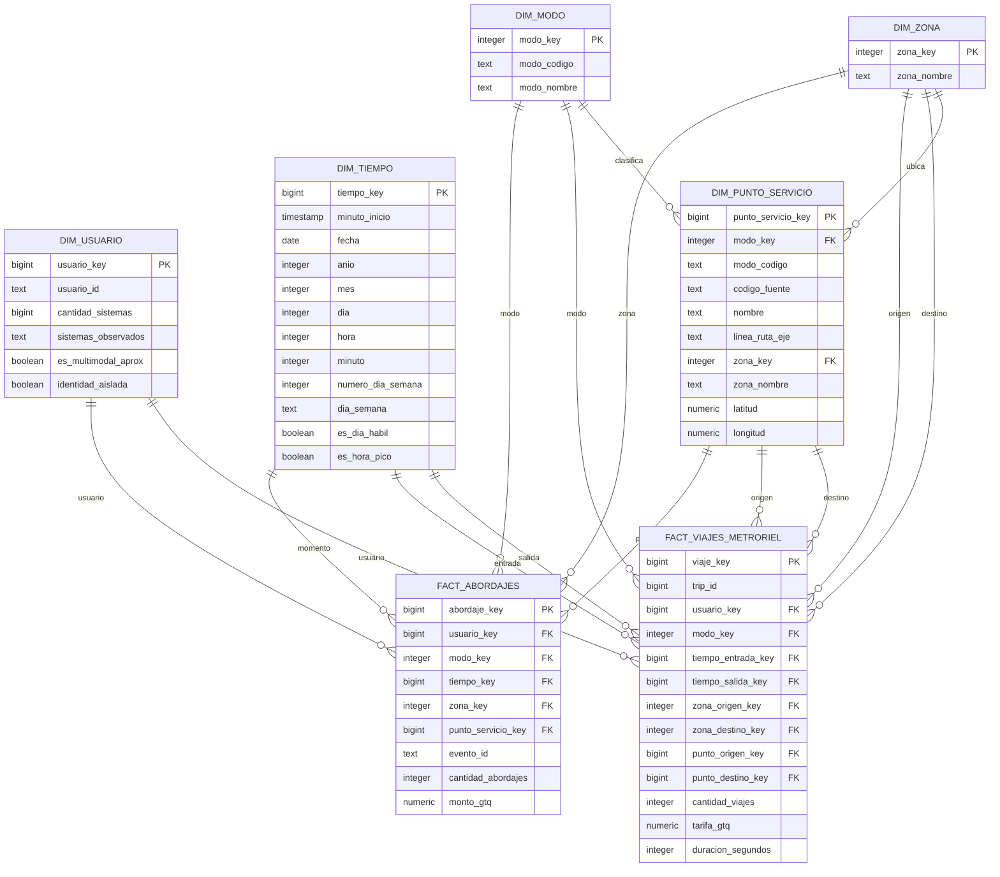

# Modelo dimensional - Capa Gold

El modelo Gold está diseñado para analizar la demanda de transporte de la
red metropolitana y conservar adicionalmente el detalle completo de los
viajes de MetroRiel.

## Grano

**fact_abordajes:** una fila representa un abordaje válido de un usuario
en un modo, punto de servicio e instante determinado.

**fact_viajes_metroriel:** una fila representa un viaje completo válido
de MetroRiel desde una estación de origen hacia una estación de destino.